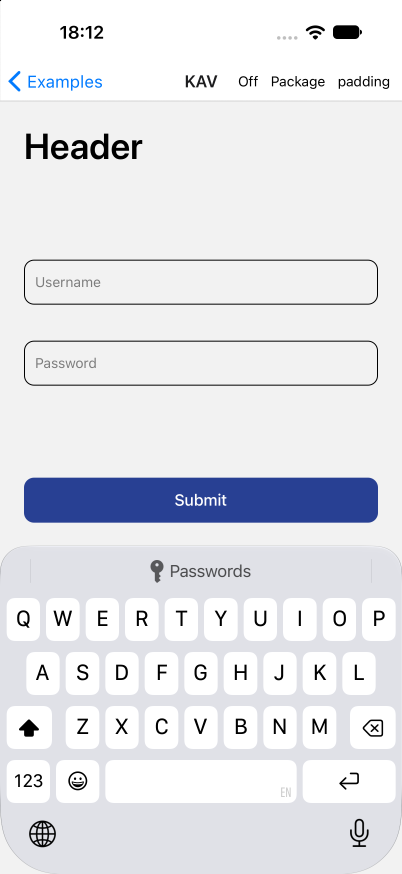

# KeyboardAvoidingView disabled layout

Open the Fabric example's KeyboardAvoidingView screen with Package and padding selected. Focus Username, then tap On in the header to disable avoidance while the keyboard remains open.

Before the fix, the disabled view keeps its keyboard padding. After the fix, it returns to its original layout. Both captures show an iPhone 18 Pro simulator running iOS 27.0.

| Before | After |
| --- | --- |
|  |  |

[Before recording](avoiding-disabled-before.mp4) · [After recording](avoiding-disabled-after.mp4)
