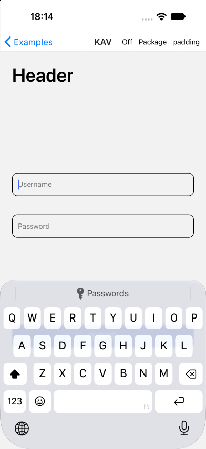
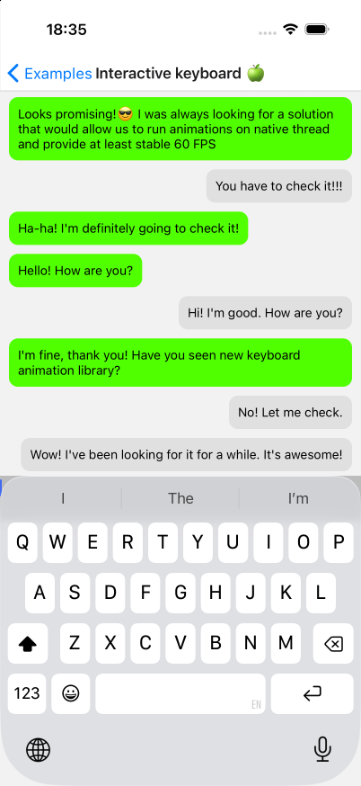
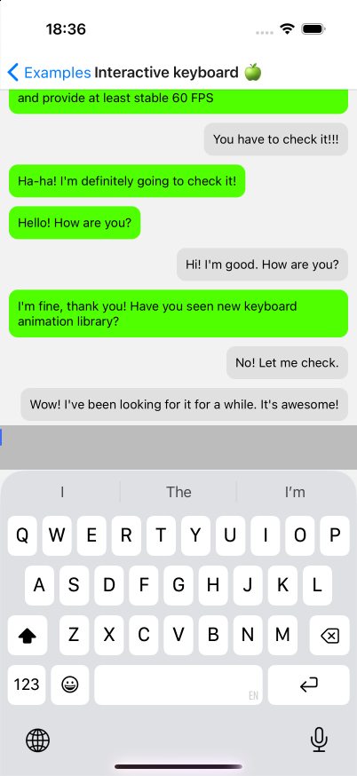

# KeyboardAvoidingView disabled layout

Open the Fabric example's KeyboardAvoidingView screen with Package and padding selected. Focus Username, then tap On in the header to disable avoidance while the keyboard remains open.

Before the fix, the disabled view keeps its keyboard padding. After the fix, it returns to its original layout. Both captures show an iPhone 18 Pro simulator running iOS 27.0.

| Before | After |
| --- | --- |
|  |  |

[Before recording](avoiding-disabled-before.mp4) · [After recording](avoiding-disabled-after.mp4)

# Native interactive dismissal padding

Open the Fabric example's Interactive keyboard iOS screen and focus the composer. On the iPhone 16 Pro simulator running iOS 26.0, the baseline's synthetic accessory leaves the 50-point composer covered by the keyboard. With native dismissal padding, the whole composer remains above it.

| Before — iPhone 16 Pro simulator, iOS 26.0 | After — iPhone 16 Pro simulator, iOS 26.0 |
| --- | --- |
|  |  |

The recordings start with the keyboard open. Drag the message beginning “I'm fine, thank you!” down to the keyboard's prediction row, hold, then release.

[Before recording](dismiss-padding-baseline-drag.mp4) · [After recording](dismiss-padding-candidate-drag.mp4)

Implementation: [92bfd418](https://github.com/chrispader/react-native-keyboard-controller/commit/92bfd418268abb974b3bf76c1cbdb7d9a768c34c).

## UIKit control

`ContentView.swift` is a standalone UIKit comparison hosted by SwiftUI. Replace `ios/KeyboardControllerNative/KeyboardControllerNative/ContentView.swift` with this file, open `ios/KeyboardControllerNative/KeyboardControllerNative.xcodeproj`, and run the KeyboardControllerNative scheme on an iPhone simulator with iOS 26 or later.

Select Accessory, Native padding, or Neither, then focus Open keyboard and drag the scroll view downward. The red line follows `keyboardLayoutGuide.topAnchor`. The control uses a plain UIScrollView and UITextField, with no RNKC keyboard observer.
